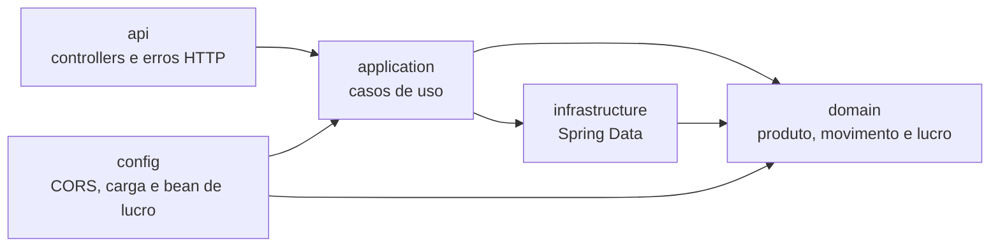
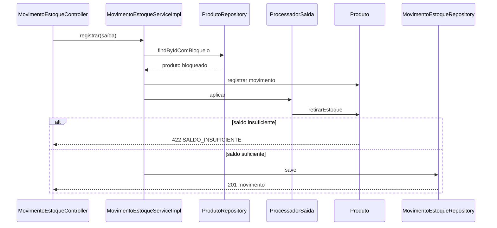

# Arquitetura do backend

A API é o único lugar onde o estoque muda e onde o lucro é calculado. O frontend pede e exibe. Quem quiser entender uma regra de saldo, de saída ou de lucro começa neste módulo.

Pacote raiz: `com.nexdom.estoque`. Spring Boot 4.2, Java 25, Spring Web MVC, Spring Data JPA, Bean Validation e H2 em memória. A aplicação sobe na porta `8080`.

## Como o código está dividido

A dependência aponta para dentro. A API HTTP conhece os casos de uso. Os casos de uso conhecem o domínio e os repositórios. O domínio não conhece HTTP, Spring MVC nem SQL.



| Pacote | Responsabilidade |
| --- | --- |
| `domain.model` | `Produto`, `MovimentoEstoque` e os enums `TipoProduto` e `TipoMovimentacao`. |
| `domain.service` | `CalculadoraLucro`. Classe Java comum, sem anotação Spring. |
| `domain.exception` | Falhas de negócio com código estável (`SALDO_INSUFICIENTE`, `REGRA_NEGOCIO`, `CONFLITO`, `NAO_ENCONTRADO`). |
| `application.service` | `ProdutoService`, `MovimentoEstoqueService` e `ConsultaEstoqueService`. |
| `application.movimentacao` | Estratégia de entrada e de saída. |
| `application.dto` | Records de entrada e de saída da API, com Bean Validation. |
| `application.mapper` | Entidade para record de resposta. |
| `infrastructure.persistence` | `ProdutoRepository` e `MovimentoEstoqueRepository`. |
| `api.controller` | Rotas `/api/produtos`, `/api/movimentos` e `/api/consultas`. |
| `api.advice` | Traduz exceção em HTTP. |
| `config` | CORS, bean da calculadora e carga de exemplo. |

`CalculadoraLucro` nasce em `DomainConfig` como bean. A regra de lucro permanece testável sem subir o Spring. O container só a entrega para `ConsultaEstoqueServiceImpl`.

## O que o domínio garante

Há dois agregados persistidos: `produto` e `movimento_estoque`. O movimento aponta para o produto (`produto_id`) e não existe sozinho.

`Produto` nasce por `Produto.novo`. Código vazio é recusado, o código gravado sai em maiúsculas e sem espaços nas pontas. Descrição em branco é recusada. Tipo é obrigatório. Valor do fornecedor nulo ou negativo é recusado e o valor aceito fica com duas casas (`HALF_UP`). Quantidade de abertura pode ser zero e não pode ser negativa.

`Produto.atualizar` muda código, descrição, tipo e valor do fornecedor. O saldo fica de fora desse método de propósito: cadastro não é movimentação.

`adicionarEstoque` soma uma quantidade maior que zero. `retirarEstoque` só conclui quando a quantidade pedida cabe no saldo. Se não cabe, lança `SaldoInsuficienteException` com o código do produto, o disponível e o solicitado. O saldo não é alterado.

`MovimentoEstoque.registrar` exige produto, tipo e quantidade maior que zero. Em entrada, `valorVenda` fica nulo. Em saída, o valor de venda é obrigatório, não pode ser negativo e também fica com duas casas. `dataVenda` omitida vira o instante atual.

O lucro mora em `CalculadoraLucro`:

`(valor de venda − valor do fornecedor) × quantidade`

Só movimentos `SAIDA` entram. O total do produto é a soma dessas saídas. O valor do fornecedor usado é o valor atual do produto. Uma alteração cadastral posterior muda o lucro recalculado das saídas já gravadas, porque o histórico não congela o custo da época.

Tipos de produto: `ELETRONICO`, `ELETRODOMESTICO`, `MOVEL`. Tipos de movimento: `ENTRADA`, `SAIDA`.

## Casos de uso

### Produto

`ProdutoServiceImpl` abre transação em escrita e transação somente leitura nas consultas.

- Criar normaliza o código e recusa duplicata com `ConflitoDadosException` (`409`). A quantidade informada é o saldo de abertura. Nenhuma linha de movimento é criada.
- Listar devolve os produtos ordenados por código.
- Atualizar recusa código já usado por outro produto e chama `produto.atualizar`. O saldo permanece.
- Excluir apaga antes os movimentos daquele produto (`deleteByProdutoId`) e depois o produto. Sem o produto, a resposta é `404`.

### Movimentação

`MovimentoEstoqueServiceImpl` não decide se soma ou subtrai. No construtor ele recebe `List<ProcessadorMovimentacao>` e monta um `EnumMap` pelo `tipo()` de cada um. Hoje existem dois componentes:

- `ProcessadorEntrada` chama `produto.adicionarEstoque`.
- `ProcessadorSaida` chama `produto.retirarEstoque`.

Um tipo novo entra como outro `@Component` que implementa `ProcessadorMovimentacao`. O serviço de registro não precisa de um novo `if`.

O registro segue esta ordem, dentro de uma transação:

1. `findByIdComBloqueio` carrega o produto com `PESSIMISTIC_WRITE`. Duas saídas simultâneas do mesmo produto esperam a mesma linha.
2. O processador do tipo informado é escolhido. Tipo sem processador vira `REGRA_NEGOCIO`.
3. `MovimentoEstoque.registrar` valida o fato (valor de venda na saída, quantidade, data).
4. O processador aplica o efeito no saldo. Na saída sem saldo, a exceção desfaz a transação: nem saldo nem movimento são gravados.
5. O movimento é salvo. O produto alterado volta ao banco pelo flush da transação.

A listagem aceita `produtoId` opcional. As consultas fazem `join fetch` do produto para o mapeamento da resposta não depender de sessão aberta fora da transação. `spring.jpa.open-in-view` está desligado.



### Consultas

`ConsultaEstoqueServiceImpl` é somente leitura.

Consulta por tipo lista os produtos daquele tipo e junta as saídas já carregadas em memória, agrupadas por produto. A resposta traz `quantidadeSaida` e `quantidadeDisponivel`. A quantidade disponível é o saldo atual do produto, não um saldo derivado na hora da consulta.

Lucro geral percorre todos os produtos com o mesmo mapa de saídas. Lucro de um produto busca só as saídas daquele id. Produto inexistente responde `404`. Produto sem saída volta com quantidade zero e lucro zero.

## Contrato HTTP

Controllers finos: validam o corpo com `@Valid`, chamam o serviço e devolvem o record. `POST /api/produtos` responde `201` com cabeçalho `Location`. `DELETE` responde `204`. `POST /api/movimentos` responde `201`.

| Método | Caminho | Efeito |
| --- | --- | --- |
| `POST` | `/api/produtos` | Cria produto e saldo de abertura |
| `GET` | `/api/produtos` | Lista por código |
| `GET` | `/api/produtos/{id}` | Busca um produto |
| `PUT` | `/api/produtos/{id}` | Atualiza cadastro, sem mexer no saldo |
| `DELETE` | `/api/produtos/{id}` | Remove produto e movimentos |
| `POST` | `/api/movimentos` | Entrada ou saída |
| `GET` | `/api/movimentos?produtoId=` | Histórico, o mais recente primeiro |
| `GET` | `/api/consultas/produtos?tipo=` | Saída e saldo do tipo |
| `GET` | `/api/consultas/lucro` | Lucro de todos |
| `GET` | `/api/consultas/lucro/{produtoId}` | Lucro de um produto |

A validação de formato (campo obrigatório, tamanho, casas decimais, quantidade mínima) fica nos records. A validação de negócio (código único, saldo, valor de venda na saída) fica no domínio e nos serviços. As duas chegam ao cliente no mesmo formato:

```json
{
  "mensagem": "Saldo insuficiente para o produto NB-001. Quantidade disponível: 6. Quantidade solicitada: 10.",
  "codigo": "SALDO_INSUFICIENTE",
  "campos": {}
}
```

| Situação | HTTP | `codigo` |
| --- | --- | --- |
| Bean Validation | `400` | `DADOS_INVALIDOS`, com `campos` por propriedade |
| JSON ilegível ou enum desconhecido | `400` | `REQUISICAO_INVALIDA` |
| Produto inexistente | `404` | `NAO_ENCONTRADO` |
| Código duplicado | `409` | `CONFLITO` |
| Saldo insuficiente | `422` | `SALDO_INSUFICIENTE` |
| Outra regra de negócio | `422` | `REGRA_NEGOCIO` |
| Falha não prevista | `500` | `ERRO_INTERNO`, com a causa só no log |

`ApiExceptionHandler` é o único ponto que escolhe o status. Serviço e domínio lançam exceção e não montam `ResponseEntity`.

A API não autentica chamada. O login da interface vive no navegador. Quem alcança a porta `8080` usa os endpoints. O CORS libera `http://localhost:5173` e `http://127.0.0.1:5173` em `/api/**`.

## Persistência

H2 em memória: `jdbc:h2:mem:estoque`. Os dados duram enquanto o processo está no ar. O Hibernate atualiza o schema na subida (`ddl-auto: update`). O console fica em `/h2-console`, usuário `sa`, senha vazia.

Índices em `movimento_estoque`: `produto_id` e `tipo_movimentacao`. Valores monetários usam `precision = 14, scale = 2`. Enums são gravados como texto.

`CargaInicial` roda fora do perfil `test`, e só quando a tabela de produtos está vazia. Ela passa pelos mesmos serviços da API, então a amostra obedece às mesmas regras. Entram um notebook, uma geladeira, uma mesa e uma smart TV, com algumas saídas e uma entrada.

## Testes

Três distâncias, de dentro para fora:

- Domínio e estratégia, sem Spring: `ProdutoTest`, `CalculadoraLucroTest`, `ProcessadorMovimentacaoTest`.
- Serviço com repositório simulado: `ProdutoServiceImplTest`, `MovimentoEstoqueServiceImplTest`, `ConsultaEstoqueServiceImplTest`.
- API de verdade, com perfil `test`, H2 `estoque-test` e `create-drop`: `EstoqueApiTest` sobe o contexto e exercita cadastro, saída aceita, saída recusada, consulta por tipo, lucro, atualização e exclusão.

O perfil `test` desliga o console H2 e a carga inicial. JaCoCo 0.8.16 grava o relatório em `target/site/jacoco` na fase `test`. `CargaInicial` fica sem cobertura nesse relatório porque o perfil de teste não a executa.

```powershell
.\mvnw.cmd test
```
