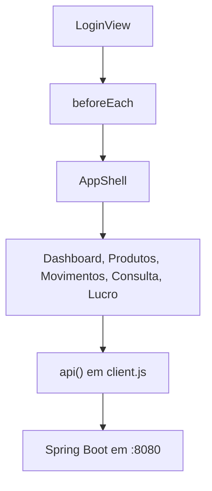

# Arquitetura do frontend

A interface é uma aplicação Vue 3.5, com Vue Router 5 e Vite 8. Ela não guarda estoque. Cada tela busca o que precisa na API, mostra o resultado e, depois de gravar, busca de novo.

Não há Pinia nem Vuex. O estado de uma tela nasce e morre com ela. O que atravessa as telas é a sessão no `sessionStorage` e a preferência do menu no `localStorage`.

O Vite escuta em `http://localhost:5173` e encaminha `/api` para `http://localhost:8080`. O código chama caminhos como `/api/produtos`. Em desenvolvimento, quem responde é o backend.

## Como o código está dividido

| Caminho | Papel |
| --- | --- |
| `src/main.js` | Cria a aplicação, instala o roteador e carrega `styles.css`. |
| `src/App.vue` | Escolhe login ou casca interna e anima a troca entre os dois. |
| `src/router/index.js` | Rotas, títulos e a guarda de sessão. |
| `src/auth.js` | Entrar, sair e decidir para onde voltar depois do login. |
| `src/api/client.js` | O único `fetch` da aplicação. |
| `src/api/labels.js` | Rótulos de tipo de produto e de movimentação. |
| `src/utils/format.js` | Moeda e data em pt-BR, e a leitura do que foi digitado. |
| `src/components/AppShell.vue` | Menu, cabeçalho, relógio e o miolo das telas internas. |
| `src/components/CampoMoeda.vue` | Campo que formata real enquanto a pessoa digita. |
| `src/components/Alert.vue` | Mensagem de erro ou de sucesso, com a lista de campos quando a API manda. |
| `src/components/ConfirmDialog.vue` | Confirmação da exclusão de produto. |
| `src/views` | Uma view por caso de uso visível. |
| `src/styles.css` | Visual único: Space Grotesk, verde `#6CCA98`, tinta `#06262D`. |



## Arranque e casca

`App.vue` olha `route.meta.publica`. A rota de login renderiza `LoginView` direto. Qualquer outra rota renderiza `AppShell`, e o `RouterView` de dentro do shell mostra a tela. A passagem entre login e aplicação usa a transição `troca`, com `mode="out-in"`.

`AppShell` desenha o menu, o título da página e a sessão. Título, eyebrow e texto de apoio vêm do `meta` da rota, então a view não repete o cabeçalho. A transição `pagina` cruza o título e o conteúdo quando a rota muda. O nome do usuário e o botão Sair ficam fora dessa animação. Com `prefers-reduced-motion`, o CSS encurta o movimento.

O menu tem Dashboard, Produtos, Movimentações, Consulta e Lucro. No desktop ele pode recolher; a escolha fica em `localStorage` na chave `nexdom-menu`. Abaixo de 860px o mesmo botão abre um menu sobre a página e um toque na rota fecha esse menu.

No canto superior direito ficam a inicial, o usuário, a data e a hora. O relógio atualiza a cada segundo e é destruído quando a casca sai. Sair limpa a sessão e volta para `/login`.

## Sessão

A autenticação é da interface. `auth.js` compara usuário e senha com `nexdom` / `nexdom`, grava `nexdom-sessao = ok` e `nexdom-usuario` no `sessionStorage` e não chama a API. Fechar a aba encerra a sessão. Se o armazenamento falhar, entrar devolve falso e a pessoa continua na tela de login.

A guarda em `router.beforeEach`:

- Rota interna sem sessão vai para `/login?redirect=` com o caminho que a pessoa tentou abrir.
- `/login` com sessão já válida vai para `/`.
- Depois de entrar, `destinoInterno` aceita só um caminho interno. Valor vazio, caminho que não começa com `/`, `//` ou `/login` caem na home. Isso impede o `redirect` de mandar o navegador para fora da aplicação.

## Telas

Cada view carrega os dados em `onMounted`, guarda erro em um `ref` e o exibe com `Alert`. Gravação bem-sucedida mostra um alerta verde e busca as listas de novo. Não há cache compartilhado entre telas: o dashboard e a lista de produtos podem ter sido carregados em momentos diferentes, e cada um mostra o que a API devolveu na sua última leitura.

| Rota | View | O que pede à API |
| --- | --- | --- |
| `/login` | `LoginView` | Nada. A sessão é local. |
| `/` | `DashboardView` | `GET /produtos`, `GET /movimentos` e `GET /consultas/lucro`, em paralelo. |
| `/produtos` | `ProdutosView` | `GET /produtos`, `POST /produtos`, `PUT /produtos/{id}`, `DELETE /produtos/{id}`. |
| `/movimentos` | `MovimentosView` | `GET /produtos`, `GET /movimentos` e `POST /movimentos`. |
| `/consulta` | `ConsultaView` | `GET /consultas/produtos?tipo=`. |
| `/lucro` | `LucroView` | `GET /consultas/lucro`. |

### Dashboard

Os três payloads viram indicadores na própria tela: quantidade de produtos, peças em estoque, lucro acumulado, volume de saída, volume de entrada e produtos com saldo zero. O gráfico por tipo, as barras de lucro e as colunas mensais de entrada e saída são contas locais em cima dessas listas. As cinco movimentações mais recentes vêm da ordem que a API já devolve, a mais nova primeiro. O botão Ver todas leva a `/movimentos`. Entrada aparece em verde e saída em vermelho.

### Produtos

A busca por código ou descrição e o filtro por tipo acontecem na lista já carregada. O formulário cria ou edita. Na edição, a quantidade some do envio: o `PUT` manda código, descrição, tipo e valor do fornecedor, e a tela avisa que o saldo não muda. A exclusão passa por `ConfirmDialog`. A API remove o produto e o histórico; a mensagem de sucesso diz isso.

### Movimentações

O formulário começa em entrada. Saída pede valor de venda e avisa, antes do envio, quando a quantidade passa do saldo conhecido da última listagem. A decisão final continua sendo da API: se duas operações concorrerem, a tela mostra a mensagem `422` que o backend devolveu. Data vazia vai como `null` e o servidor usa o instante atual. Data preenchida no input `datetime-local` ganha os segundos (`:00`) para o `LocalDateTime` da API.

### Consulta e lucro

A consulta troca o tipo por chips e soma, na tela, a saída e o disponível das linhas recebidas. A quantidade de saída usa a cor de perigo. O disponível zero ganha o destaque de saldo esgotado.

A tela de lucro soma a quantidade de saída e o lucro de todas as linhas. Lucro negativo fica marcado. A conta em si não é refeita no navegador: o número exibido é `totalLucro` da API.

## Cliente HTTP

`api(path, options)` é a fronteira com o backend.

- Prefixa `/api` e envia `Content-Type: application/json`.
- Falha de rede vira a mensagem de que a API não está no ar.
- `204` devolve `null`. É o caso do `DELETE`.
- Corpo de erro usa `mensagem`, `codigo`, `campos` e `status`. A view mostra `mensagem` e, quando existem, os campos do `400`.
- Sucesso devolve o JSON já interpretado.

Os enums viajam como texto, iguais aos nomes Java: `ELETRONICO`, `ENTRADA`, `SAIDA`. `labels.js` só traduz para a frase que a pessoa lê.

## Dinheiro

O campo monetário trabalha em centavos. `formatarMoedaDigitacao` fica com os dígitos, limita a 14 e divide por 100. Digitar `320050` aparece como `R$ 3.200,50`. `CampoMoeda` aplica isso a cada tecla e devolve o cursor para o fim.

Na hora de gravar, `numeroDeMoeda` lê os mesmos dígitos e o payload manda string com duas casas (`toFixed(2)`). O `BigDecimal` do backend recebe `3200.50`, sem ambiguidade de vírgula. Na edição, `moedaCampo` pega o número da API e o recoloca no formato de digitação.

`moeda` e `dataHora` servem só para exibir, com `Intl` em pt-BR. Valor ausente aparece como travessão.

## Testes

Vitest 5 roda em jsdom. Os arquivos `*.test.js` cobrem o que decide comportamento fora das telas: formatação, sessão, rótulos, cliente HTTP com `fetch` simulado, `CampoMoeda` e a guarda do roteador. As views estão fora dessa suíte. A cobertura v8 sai em `coverage/index.html`, pasta ignorada pelo git.

```powershell
npm test
npm run test:coverage
```

`npm run test:watch` repete a suíte enquanto os arquivos mudam.
